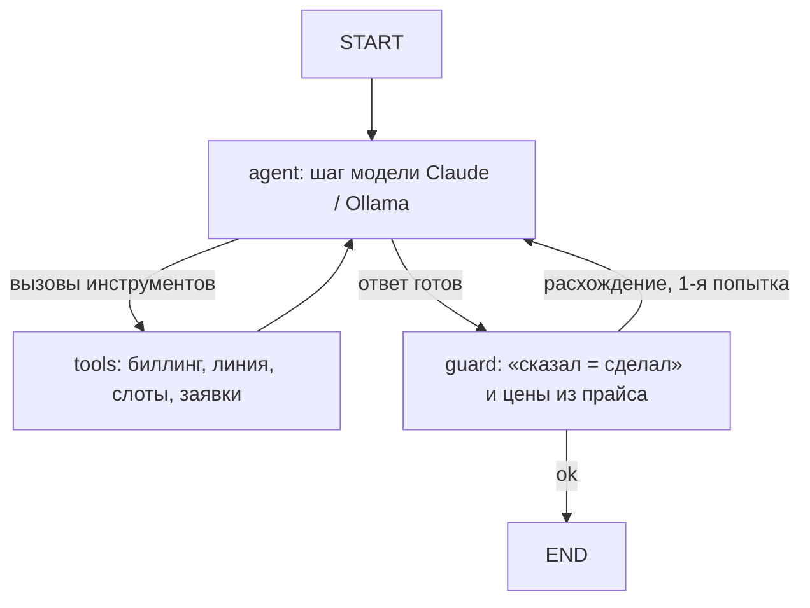

# SkyNet AI: виджет для сайта и внутренний интерфейс для сотрудников

Прототип для хакатона SkyNet (27–29.11.2026). Готовы решения под все пять направлений, команда выбирает одно. Подробно о каждом и об экономике — в [docs/cases.md](docs/cases.md). Результаты проверки — [docs/results.md](docs/results.md), каркас презентации к защите — [docs/presentation.md](docs/presentation.md).

| Направление | Что делает ИИ | Где решает человек |
|---|---|---|
| **Клиентские обращения** | Сентинел ловит проблему в сети до жалобы; бот первой линии видит линию, аварии и баланс, решает сам или бронирует мастера | выезды, NOC, злые клиенты |
| **Подключение** | проверка адреса → подбор тарифа → честный расчёт → запись на монтаж | договор |
| **Бизнес-клиенты** | только сбор брифа и проблем → передача менеджеру; черновик решения виден одному менеджеру | всё общение и КП |
| **Качество** | проверка 100% диалогов по чек-листу с цитатами, «как надо было», универсальные скрипты | калибровка |
| **Реклама** | 3 варианта под сегмент и канал + фактчек цифр и закона о рекламе | одобрение к отправке |

**Для клиентов** — виджет: `static/widget.js`. Подключается на сайт одной строкой и выбирает режим сам: подключение, поддержка для вошедших в личный кабинет или бизнес. Стили изолированы через Shadow DOM, ответы приходят живыми карточками: расчёт, слоты, заявка, «Что дальше».

**Для сотрудников** — `/staff.html`. Вкладки:
- пульт сети;
- диалоги с тоном клиента;
- заявки на подключение;
- B2B-брифы;
- качество;
- коммуникации;
- экономика (финмодель).

Общие механизмы:
- **«Сказал = сделал».** Если бот утверждает, что записал, создал или передал, а действия в журнале нет, он получает возврат на исправление.
- **Каждая сумма — из прайса или расчёта.** Иначе ответ не уходит клиенту.
- **Голос не уходит в облако.** Диктовка и звонки расшифровываются локально через faster-whisper.

## Агентная архитектура: LangGraph + Langfuse

Поддержка, подключение и B2B работают через один граф LangGraph (`app/graph.py`):



**Трассировка.** Ключи `LANGFUSE_*` в `.env` включают Langfuse. В трассе каждого ответа — узлы графа, запросы к модели с токенами, вызовы инструментов с аргументами и результатом; `session_id` — диалог виджета, `user_id` — клиент. Без ключей всё работает так же, только без трасс.

## Запуск

```bash
python3 -m venv .venv && source .venv/bin/activate
pip install -r requirements.txt
pip install -r requirements-voice.txt   # локальная диктовка (модель whisper ~480 МБ скачается при первом использовании)
cp .env.example .env                   # ANTHROPIC_API_KEY или LLM_PROVIDER=ollama
uvicorn app.main:app --port 8000
```

Откройте:
- http://localhost:8000 — демо-страница с виджетом;
- http://localhost:8000/staff.html — интерфейс сотрудников.

Через Docker: `docker compose up --build`.

**Встраивание на сайт.** `<script src="https://AI-HOST/widget.js" data-mode="auto" async></script>`. Домены сайта задаются в `WIDGET_ORIGINS`. Для поддержки сайт передаёт клиента: `data-client="…"` или `SkyNetAI.login(id)`.

| Модель | `.env` |
|---|---|
| Дешёвое демо (по умолчанию) | `CLAUDE_MODEL=claude-haiku-5-5` |
| Умный режим | `CLAUDE_MODEL=claude-opus-5-5` |
| Офлайн без ключа | `LLM_PROVIDER=ollama`, `OLLAMA_MODEL=qwen3.5:9b-64k` |

## Проверка

```bash
python -m pytest -q                         # 23 теста без LLM, включая граф с поддельной моделью
python -m scripts.eval_sentinel --seeds 20  # Сентинел: recall 99%, всё раньше первой жалобы, 0 ложных
python -m scripts.eval_cases comms          # фактчек рекламы: 7/7
python -m scripts.eval_cases quality onboarding b2b   # на модели из .env
python -m scripts.eval_agent                # сценарии поддержки
python -m scripts.eval_agent --no-guard     # то же без автопроверки «сказал = сделал» — база для сравнения
python -m scripts.eval_cases onboarding b2b --no-guard
python -m scripts.results                   # сводка всех отчётов из reports/ → docs/results.md
python -m app.cases.finmodel                # финмодель по всем направлениям и LLM-провайдерам
python -m scripts.hh_salaries               # обновить зарплаты (hh.ru, «Работа России»)
```

> ⚠️ **Ограничения.**
> - Телеметрия, биллинг, график мастеров, тарифы и каталог B2B — демо-данные в `data/`. На пилоте их заменяют адаптеры к системам SkyNet.
> - В финмодели часть предпосылок — оценки команды, они помечены. Выборки hh.ru небольшие: 10–40 вакансий на роль.
> - Агентные сценарии проверены на локальной Qwen 3.5 9B; на Claude их нужно прогнать тем же eval, когда будет ключ.
> - Отправка персональных данных зарубежному провайдеру LLM требует проверки по 152-ФЗ; альтернативы — GigaChat, YandexGPT или локальная модель, переключается в `.env`.

## Структура

```
app/main.py            API, виджет-эндпоинт, журнал диалогов
app/network.py         симулятор сети → адаптер к мониторингу на пилоте
app/sentinel.py        детекторы и инциденты
app/ops.py             биллинг (мок), мастера, очередь действий AUTO/APPROVAL
app/agent.py, tools.py ИИ первой линии
app/cases/             onboarding · b2b · quality · comms · finmodel · common (проверки «сказал=сделал» и цен)
app/graph.py           граф LangGraph: agent → tools → guard
app/llm.py             адаптеры Claude / Ollama
app/tracing.py         Langfuse (включается ключами)
app/emotion.py voice.py kb.py
static/widget.js       виджет для сайта · site-demo.html · staff.html
data/                  плейбуки, базы знаний, прайсы, размеченные диалоги и тексты, предпосылки финмодели
scripts/               eval-скрипты и сбор зарплат
```
